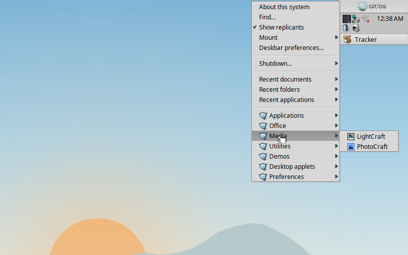

# Deskbar menu

The Deskbar menu of an air/OS install has seven folders, in this order:
Applications, Office, Media, Utilities, Demos, Desktop applets and
Preferences. Media came on 2026-10-19, after the 2026-10-18 Office
integration (following `airos-deskbar-menu` and `deskbar-utilities-root` on
2026-10-17). Turbo Chook left the images on 2026-10-19.

| Folder | Entries |
| --- | --- |
| Applications | airShot, airTime, Amp, Burrow, DeskCalc, HaikuDepot, Icon-O-Matic, Installer, Kiri, Mail, MediaConverter, MidiPlayer, Pe, People, SoftwareUpdater, SoundRecorder, StyledEdit, Summit, Terminal |
| Office | Clipper, WordCraft, GridCraft, DeckCraft, PdfCraft |
| Media | PhotoCraft, LightCraft |
| Utilities | CharacterMap, CodyCam, Debugger, Devices, DiskProbe, DiskUsage, DriveSetup, Expander, Magnify, PoorMan, SerialConnect, Vision |
| Demos | Chart, Clock, Cortex, FontDemo, GLTeapot, Mandelbrot, OverlayImage, Pairs, PatchBay, Playground, Pulse, Sudoku |
| Desktop applets | AutoRaise, BluetoothStatus, LaunchBox, NetworkStatus, PowerStatus, ProcessController, WiFiStatus, Workspaces |
| Preferences | Appearance, Backgrounds, Bluetooth, DataTranslations, Deskbar, E-mail, FileTypes, Input, Keymap, Locale, MCP, Media, Network, Notifications, Power, Printers, Repositories, Screen, ScreenSaver, Shortcuts, Sounds, Time, Tracker, VirtualMemory, WiFi (and Qt6 Configurator from the qt6_base package) |

WebPositive is gone: Summit is the browser (the MIME database already made it
the preferred application for web pages and http/https URLs). The fork no
longer builds the `webpositive` package or puts it in an image or in the
Haiku repository; the sources stay for Mail, which compiles WebPositive's
autocompletion classes. ActivityMonitor and MediaPlayer are still installed,
without a menu entry (airTime is the media player).

## Where each entry comes from

The menu is the merge of the `data/deskbar/menu` directories listed in
`data/deskbar/menu_entries`; packagefs merges the packages' own entries in
`/boot/system/data/deskbar/menu`.

- The haiku package: `DESKBAR_APPLICATIONS`, `DESKBAR_UTILITIES`,
  `DESKBAR_DESKTOP_APPLETS`, `SYSTEM_PREFERENCES` and `SYSTEM_DEMOS` in
  `build/jam/images/definitions/minimum` and `regular`, turned into links by
  `build/jam/packages/Haiku`. Debugger's entry used to be
  in haiku_devel; it is in the haiku package now, under Utilities.
- The applications air/OS CI builds (airShot, airTime, Amp, Burrow, Kiri,
  Summit): each package's own
  `data/deskbar/menu/Applications/<name>` link. Clipper and the four Craft
  applications supply `data/deskbar/menu/Office/<name>` links, PhotoCraft and
  LightCraft `data/deskbar/menu/Media/<name>` links. The new Terminal and
  MediaConverter replace the in-tree apps under the same names, so their
  entries stay as they are.
- Pe: HaikuPorts' package (the nightly profile adds it), as it is.
- Vision: HaikuPorts' build, repacked by air/OS CI with its link in
  `Utilities` and the revision raised by 101 (0.10.6-103; airos-ci
  `deps/deskbar-repack.sh`, called by `images/build-image.sh`). The x86_64
  profile in `tools/airos/ci/UserBuildConfig` keeps the repository's own
  Vision out when CI staged one (`SuppressHaikuImagePackages`, a rule this
  branch added to `build/jam/ImageRules`).

Office and Media have their localized names in
`src/data/directory_attrs/deskbar-office.rdef` and `deskbar-media.rdef` and
share the same catalog and ordering mechanism. Utilities' localized name is `src/data/directory_attrs/deskbar-utilities.rdef`
with its catalog entry in `src/apps/deskbar/LocalizedFolders.h`. The menu
itself would sort its folders by name, which puts Utilities last;
`TDeskbarMenu::_OrderStandardFolders()` (`src/apps/deskbar/DeskbarMenu.cpp`)
puts the seven standard folders first in their own order, by entry name, and
anything else (a folder a user adds to `~/config/settings/deskbar/menu`)
follows them, sorted as before.

Pe and Vision are x86_64 only: HaikuPorts has no arm64 builds, so the ROCK 5,
Pi and Cubie images have the same menu without those two entries.

On 2026-10-18, all four release images were built from Haiku `ea650d9960`
(upstream through `8673bcc864`) with airos-ci `3e02433`. All five Office
packages were read back from each image's BFS volume, matched against the
manifest hashes, and checked for their Office links and executable targets.

| Release image | Verification |
| --- | --- |
| x86_64 | QEMU BIOS and UEFI graphical boot; all five Office apps and PDF CLI |
| ARM64 / ROCK 5 | QEMU UEFI graphical boot; all five Office apps and PDF CLI |
| Raspberry Pi 4 | SD partition layout, required boot files and Office packages |
| Cubie A7S | GPT, boot chain, ESP contents, Office packages and QEMU UEFI desktop |

Clipper, WordCraft, GridCraft, DeckCraft and PdfCraft launched and remained
running in disposable guests made from the final x86_64 and ARM64 images;
`pdfcraft-cli --version` succeeded on both. An ARM64 crypto probe also passed
SHA-256, AES-GCM, Ed25519 and system-randomness checks. The screenshot above
shows all five entries, with Office between Applications and Utilities.
Application sources are pinned in airos-ci's `apps/office.lock.json` (and,
since 2026-10-19, `apps/media.lock.json`); image
manifests record those pins, the Haiku and buildtools revisions, and compiler
versions. Physical GPU and board-peripheral tests were not rerun for this
build integration.

On 2026-10-19, Media was added and Turbo Chook dropped (airos-ci `0183522`:
`apps/build-pinned.sh` and `images/verify-pinned.sh` build and check Office
and Media from their lock files). The x86_64 image from `76c3386053` and the
ARM64 and Raspberry Pi 4 images from `c28cd80a26` (built from the build
server's dashboard, as the GitHub runner was down) passed their smoke tests;
their manifests list PhotoCraft 0.10.0~airos1-2 and LightCraft 0.9.1~airos1-2
and no Turbo Chook. In QEMU, the x86_64 and ARM64 menus show Media between
Office and Utilities (screenshot above), Applications has no Turbo Chook, and
PhotoCraft and LightCraft start from their Media entries, on the CPU there
(QEMU has no GPU; the ARM64 images have no Vulkan loader, so the two apps
render on the CPU on ARM64 boards too). The Pi image's haiku package has the
Media folder.
