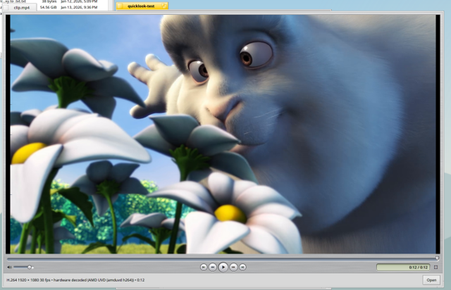

# Quick Look

Press the space bar on a file in Tracker and a panel shows what is in it:
text, pictures, films and songs, as the Finder's Quick Look does. Space or
Escape closes it again; the arrow keys move on to the next file while it is
up; `⌘Y` and *File ▸ Quick Look* do the same as the space bar. Since branch
`quick-look` (2026-10-15).



## What previews what

| Kind | Preview | Lives in |
| --- | --- | --- |
| Text: `text/*`, JSON, XML, YAML, scripts, source code, subtitles, untyped files that read as text | A read-only text view, proportional and wrapped for prose, fixed and unwrapped for code; UTF-8, or Latin-1 when the bytes are not UTF-8; the first 2 MiB of a big file | `add-ons/quick_look/TextPreview` (haiku package) |
| CSV and TSV | A table, the first row as the column titles (commas, semicolons or tabs, quoted fields) | the same add-on |
| Pictures: everything the Translation Kit reads (`image/*`) | Scaled to fit, on a dark ground; the footer says the size and kind | `add-ons/quick_look/ImagePreview` (haiku package) |
| Films, and songs when Amp is not installed: everything FFmpeg reads | airTime's own engine and video view, playing at once, with the metal controller; the footer says the codec, size, frame rate and whether the picture is decoded in hardware | `add-ons/quick_look/airTime` (airtime package) |
| Songs: MP3, MP4/M4A/AAC, FLAC, WAV, OGG, AIFF | Amp's decoder and output, the artwork and tags, play/pause and a scrubber | `add-ons/quick_look/Amp` (amp package) |
| Documents: PDF, XPS, EPUB, FB2, comic book archives (MuPDF) | The pages stacked in a scrolling view at the panel's width, rendered as they come into view at the desktop's density; the footer says the page count, title and format | `add-ons/quick_look/PDFPreview` (haiku package, x86_64) |
| Anything else, and folders | The icon, name, kind, size and date (a folder's item count) | the server itself |

Several selected files are shown one at a time, with `‹ 2 of 5 ›` in the
footer. The *Open* button opens the file in its preferred application, as a
double click on a film or a song does; the panel then closes.

## How it is built

```
headers/os/add-ons/quick_look/QuickLook.h   the add-on API (BQuickLookAddOn, BQuickLookPreview)
headers/private/quicklook/QuickLookDefs.h   the Tracker ↔ server protocol
src/kits/quicklook/            libquicklook.so: the base classes
src/servers/quick_look/        quick_look_server: the panel, the add-on manager, the generic preview
src/add-ons/quick_look/        the text and image add-ons
src/kits/tracker/QuickLook.*   Tracker's side: finds or starts the server
```

- **Tracker** (`BPoseView`) turns the space bar into a Quick Look when it is
  not part of a name being typed or a type-ahead filter, builds a message
  with the selection's refs and the window's frame, and sends it to the
  server by signature (`application/x-vnd.Haiku-quick_look_server`),
  launching it through the roster when it is not running
  (`data/launch/system` lists it on demand). While the panel is up, every
  change of the selection sends the new refs (coalesced over 50 ms, for a
  held arrow key) marked `"update"`: the server only swaps the content of a
  panel that is up for that window, and a server that is not running is
  not started for it, so a restarted server never pops the panel up on a
  plain click. The server is a `BServer`: only its constructor asks
  launch_daemon for the port made for an on-demand service, and as a plain
  `BApplication` it read its own port while Tracker's messages queued
  unread in launch_daemon's (found after the first package install); Escape, a closed window and the window losing the
  keyboard hide it. The server tells the owner when the panel is up
  (`kMsgQuickLookShown`) and when it closed (`kMsgQuickLookClosed`), so the
  two agree even when the server was restarted in between.
- **The panel** is a frameless `BDirectWindow` (a dark line around it,
  the file's name in bold in the footer) with `B_FLOATING_ALL_WINDOW_FEEL`
  and `B_AVOID_FOCUS`: it floats over everything and never takes the
  keyboard, so Tracker's arrows keep working. Tracker sends where the
  selected entry is on screen (`"icon"`), and the panel zooms out of that
  rectangle into its place and shrinks back into it when it closes. The
  zoom follows the clock (220 ms, eased, a frame about every 12 ms, late
  frames dropped), and the preview is hidden while it runs and laid out
  once when the panel is there: laying out text, scaling a picture or
  rendering a page at every size in between is what made it stutter. The
  preview is started when the zoom ends (and stopped before the shrink),
  so a film's first picture and its clock begin together; on the X399 a
  zoom is 18 frames in 228 ms with no frame over 8 ms. Its `DirectConnected()` is passed to the
  preview, so airTime's video view writes into the frame buffer as it does
  in its own window. The panel is centred on the Tracker window that asked
  (which keeps it on that monitor), sized to the content's preferred size
  and at most 85 % of the screen, and resizable.
- **Add-ons** are loaded from every `add-ons/quick_look` directory
  (`BPathFinder`, so packaged, non-packaged and the user's all count). Each
  bids with `Supports(ref, type)` (0 to 1) and the best makes the view with
  `CreatePreview()`; a failure goes to the next bidder, and the generic
  preview comes last. The directories are looked at again when their
  modification time changes, so an application installed later is found
  without a restart; a loaded add-on is never unloaded while the server
  runs, because its preview's threads may still be running (this was the
  first crash). The server quits three minutes after the panel closed.
- The preview's `Start()` is called once it is in the window and shown,
  `Stop()` before it is removed; after `Stop()` returns no thread of the
  add-on may touch the view. The old preview is stopped before the next is
  created, so there is one player at a time.
- The previews that play media are **built from the applications' own
  sources** (`src/quicklook/` in airTime and Amp, the engine objects
  compiled again as position independent code), and shipped in the
  applications' packages. The system has the panel and the plain previews;
  the players exist once each. The applications' Makefiles build the add-on
  when the SDK has `add-ons/quick_look/QuickLook.h` (`QUICKLOOK=1` forces
  it, with `QUICKLOOK_CPPFLAGS`/`QUICKLOOK_LDFLAGS` for headers and library
  elsewhere), so a CI with an older SDK still builds the applications.

- **PDFPreview** links HaikuPorts' `libmupdf.so` (mupdf 1.20.3, AGPL;
  jbig2dec with it). The build's pinned HaikuPorts snapshot has neither, so
  the `mupdf` build feature takes the packages from
  `HAIKU_MUPDF_PACKAGES_DIR` (air/OS CI fetches mupdf, mupdf_devel and
  jbig2dec with `deps/haikuports.py` and puts the two runtime packages in
  the image; locally `/mnt/HaikuWork/x399/pkgs/mupdf`). Without the
  feature the add-on is left out (`PDFPreview@mupdf`), as on arm64 for
  now, where PDFs fall back to the icon. Rendering happens on a thread of
  the add-on's own that owns the MuPDF context (MuPDF contexts are single
  threaded without locks): it first reports the page count, sizes and
  metadata, then renders the pages the view asks for, nearest first, at
  the view's scale times the desktop's device scale (from `BScreen`'s mode
  against its frame, 2 on the X399), keeping the last 24 pages.

## Writing an add-on

```cpp
#include <add-ons/quick_look/QuickLook.h>

class MyPreview : public BQuickLookPreview {
	BSize PreferredContentSize() { return BSize(640, 480); }
	BString Summary() { return "what the footer says"; }
	void Start() {}   // the panel is up: play
	void Stop() {}    // stop every thread; the view goes away next
	void Draw(BRect update) { ... }
};

class MyAddOn : public BQuickLookAddOn {
	float Supports(const entry_ref&, const char* type)
		{ return strcmp(type, "application/x-mine") == 0 ? 0.9f : 0; }
	BQuickLookPreview* CreatePreview(const entry_ref& ref, const char*,
		BString* error) { return new MyPreview(ref); }
};

extern "C" BQuickLookAddOn* instantiate_quick_look_add_on(image_id image)
	{ return new MyAddOn(image); }
```

Link with `-lquicklook -lbe`, build as a shared object with `-fPIC`, and
install it in `add-ons/quick_look/`. `NotifyChanged()` tells the panel that
`PreferredContentSize()` or `Summary()` changed (a film whose decoder was
only chosen on the first picture). The view's frame can change at any time;
a `BDirectWindow` preview gets the window's `DirectConnected()` calls.

## Verified on the X399 (2026-10-15)

WX 5100, 200 % desktop, master `quick-look` branch built in
`build/master-x86_64`, airTime and Amp built natively on the machine:

- CSV as a table, JSON in a fixed font with horizontal scrolling, prose
  wrapped; PNG and JPEG scaled and labelled; untyped random bytes and a
  film without airTime's add-on fall back to the icon preview.
- A three-page PDF made by hand and the 137-page AHCI 1.3.1 specification
  show their pages, titles and formats; the wheel scrolls and pages render
  as they appear.
- `clip.mp4` (H.264 1080p30) and `hevc10.mkv` (HEVC Main 10) play in the
  panel decoded by the AMD UVD through the `amduvd` VA-API add-on; the
  footer says so. `song.mp3` plays through Amp's add-on with its artwork and
  tags.
- Arrow keys move the preview through the folder, across the three kinds
  of add-on; Escape closes; three selected files show `1 of 3` with arrows;
  *Open* opens the file in StyledEdit and closes the panel; the File menu
  shows *Quick Look ⌘Y*.

Two crashes found and fixed on the way: the add-on manager unloaded a
rescanned add-on under a running preview (it no longer unloads), and the
`amduvd` add-on freed its VA-API device with each decoder, which made libva
close the Mesa driver while the driver's static "frame copy" threads still
existed (the add-on now keeps one device per render node for the life of
the program, see `src/add-ons/media/plugins/amdgpu_va`).

## Open

- A text preview reads the first 2 MiB only; a table shows 20,000 rows.
- An add-on replaced while the server runs is seen when the server next
  starts (it quits three minutes after the panel closed).
- Office documents have no add-on; they fall back to the icon. PDF needs
  mupdf, which the arm64 builds do not have yet (an airos-ci recipe would
  bring it there).
- The document preview has no page jumping or zoom; the mouse wheel and
  the scroll bar move through the pages.
